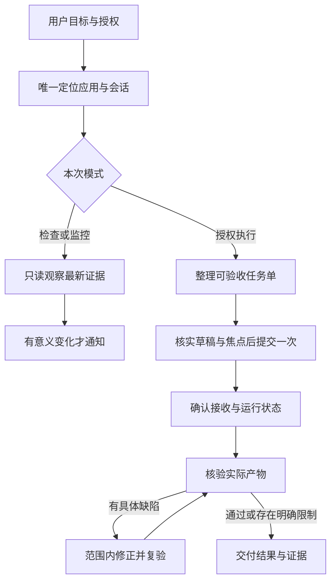

# DeepSeek Harness Control

让 Codex 在 macOS 上可靠地操作 **DeepSeek Harness（DSH）**：找到正确会话、下发已授权任务、检查进展，并用实际文件验收结果。

这是从桌面实操中整理的社区工作流 skill，本分支改为面向 macOS。它不捆绑 DeepSeek Harness、Computer Use 插件或 `@oai/sky`，也不是 DeepSeek 官方接口。

## 改进了什么

- **减少误操作**：唯一选窗，核对真实画面，输入前确认焦点；裁剪、白屏、弹窗或用户切换后重新观察。Mac 上开发版可能显示为 `Electron`，浏览器里也常开着别的本地页面，不凭进程名或端口选窗。
- **避免重复任务**：分开记录“输入”“提交”“接受”“运行”“验收”。发送超时先查是否已接收，不盲重发。
- **让交付可信**：Harness 的“已完成”进入待验收阶段；检查实际产物和必要的独立证据，未知项如实保留。
- **监控保持安静**：状态不变不刷屏；同一异常只提醒一次。只读监控不代选、不发任务、不自动重启。
- **减少上下文浪费**：任务单替代长聊天转发，读取最新相关消息，修正时只发送具体失败证据。



## 使用条件

1. macOS 上已运行 DeepSeek Harness，形态不限：打包版桌面应用（“DeepSeek Harness”）、源码开发版桌面应用（据源码名为 “Harness Dev”，进程名可能为 `Electron`），或浏览器里打开的 `dsh web` 页面（默认 `127.0.0.1:3080`）。
2. 当前 Codex 环境可使用 `computer-use:computer-use` 技能（Codex Computer Use 插件）、`node_repl` 与 `@oai/sky`。
3. 已在“系统设置 → 隐私与安全性”中为 Codex Computer Use 开启**屏幕录制**与**辅助功能**。
4. 用户已指定或上下文能唯一确定目标会话。执行模式还需要用户授权任务范围。

仅安装这个 skill 不会增加桌面控制权限。缺少上述能力时，它仍可协助整理任务和核查已授权文件，但不能直接操作 Harness。

已运行的 Harness 桌面版没有受支持的外部控制接口，因此本 skill 通过 Computer Use 操作界面，不读取调试端口或 `~/.dsh` 会话文件。若你自己启动了 `dsh web` 并愿意提供访问方式，可改用官方 API；不提供时仍走浏览器界面。要点见 [sky-workflow.md](skills/deepseek-harness-control/references/sky-workflow.md)。

## 安装

### 从本地仓库安装（推荐）

先克隆仓库（`main` 即 macOS 版），再把 skill 目录链接到 Codex 的用户技能目录：

```bash
git clone https://github.com/StivoEgg/deepseek-harness-control.git
cd deepseek-harness-control
ln -s "$PWD/skills/deepseek-harness-control" ~/.codex/skills/deepseek-harness-control
```

软链接会随仓库更新立即生效；想固定为某一版，把 `ln -s` 换成 `cp -R "$PWD/skills/deepseek-harness-control" ~/.codex/skills/`。卸载时删除 `~/.codex/skills/deepseek-harness-control` 即可（软链接只删链接，不动仓库）。

安装后**重启 Codex 或新开会话**，让它重新扫描技能。

### 确认装的是 macOS 版

```bash
sed -n 3p ~/.codex/skills/deepseek-harness-control/SKILL.md | cut -c1-40
```

输出应以 `description: "在 macOS 上控制` 开头。若看到 “Windows”，说明装的是旧版。

### 通过技能安装器

`$skill-installer` 只会装它指向的分支或仓库里的内容。上游 `emo-tao/deepseek-harness-control` 的 `main` 是 Windows 版，**不要用它的地址安装本 skill**。本仓库 `main` 是 macOS 版，可将地址指向 `https://github.com/StivoEgg/deepseek-harness-control/tree/main/skills/deepseek-harness-control`（该安装器路径尚未实测，装完请用上面的方法确认版本）。

其他安装方式与目录规则见 [OpenAI 官方技能文档](https://learn.chatgpt.com/docs/build-skills)。

## 调用示例

只读检查：

```text
使用 $deepseek-harness-control 检查 Harness 中“示例项目”会话，告诉我当前结果和需要我处理的问题，不发送消息。
```

继续执行：

```text
使用 $deepseek-harness-control 继续“示例项目”会话的导出修复。
只修改我指定的输出目录，保留原始工程。完成后独立检查字段、单位和输出文件。
```

持续监控：

```text
使用 $deepseek-harness-control 持续监控“示例项目”会话。
仅在完成、报错、需要我操作或无法继续观察时提醒；不要自动发消息或重启。
```

先规划、再交给 Harness 开发、最后独立验收：

```text
先不要动手。第 1 步：你读 {项目目录} 相关代码，出实施计划，拆成可独立验收的小任务（目标、改动文件、验收命令），发给我确认；我回复“确认”前不要使用 Harness。
第 2 步：确认后用 $deepseek-harness-control，在 {目标页面或应用} 的 {工作区} 里一次发一个小任务。只可修改 {允许目录}；不要改 {保护项}；不要 git commit / push。Harness 提问或要权限时先停下问我。
第 3 步：每个小任务做完，你自己运行 {测试命令} 并核对实际文件，不要采信 Harness 的“已完成”。未通过就整理具体失败证据，只发一次修正任务；同一问题两轮没修好就停下报告。
```

要点：授权范围写清楚；会话名要唯一；详细规格写进项目文件、任务单里只给路径，避免长文逐字输入；验收标准要可检查（命令、测试、文件内容）。

持续监控需要当前环境提供正式调度能力；skill 自身不是后台守护进程。

## 目录

```text
skills/deepseek-harness-control/
  SKILL.md                     触发范围、操作模式、提交与验收流程
  agents/openai.yaml           Codex 技能名称与默认调用提示
  references/sky-workflow.md   macOS 授权、窗口、焦点、截图与恢复细节
  references/task-contract.md  任务单、提交记录与监控模板
docs/validation.md             检查结果与行为验收场景
```

**阅读入口**：[SKILL.md](skills/deepseek-harness-control/SKILL.md) · [验证说明](docs/validation.md)

验证状态见 [docs/validation.md](docs/validation.md)：识别与只读检查已在 macOS 真机验证；提交、运行状态判断与验收的完整流程仅有使用者的口头回报，细节未记录，仍按“待核实”处理。

发布包使用通用示例，不包含真实会话截图、运行日志、私人路径、论文、仿真数据或凭据。运行时产生的提交记录应保留在自己的项目中。

## English summary

A workflow skill for Codex to control DeepSeek Harness on macOS through the Codex Computer Use runtime (requires Screen Recording and Accessibility permissions). It handles the packaged app, the source dev build (possibly shown as `Electron`), and `dsh web` in a browser tab, separates read-only monitoring from authorized execution, verifies the target window and composer focus, prevents blind resubmission, and checks actual artifacts before reporting success. Runtime dependencies are supplied by the user's environment, not this repository.
